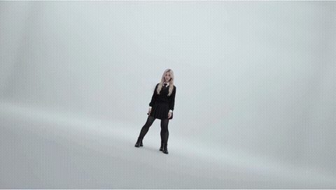

# 双人舞 · 简化校服 · 原生六步定版 V1

## 适用范围

本仓库固化本次双人舞的实际配置与输入引用；媒体输入在本地归档，不随 GitHub 仓库上传；`demo/` 仅提供最终成片与预览。参考图先做人物分割用于模型条件，最终视频由模型生成整幅画面；不对输出人物做抠图贴回背景。模型与节点保持既有版本，不使用 V4。

本包是逐镜头可导入工作流集合，不是适用于任意视频的一键通用模板。换源片须重新检查人物身份、构图、遮罩、时长和分镜。

## Demo

[](demo/uniform-full-20.333s.mp4)

[播放完整 Demo（20.333 秒，含原音轨）](demo/uniform-full-20.333s.mp4) · [直接下载 MP4](https://raw.githubusercontent.com/mollymogi/mogi-sacil2-dance-workflow/main/demo/uniform-full-20.333s.mp4)

上方动图仅展示开头 6 秒、无声音；点击观看完整 MP4。完整成片为 960×544、24fps、488 帧，含 10 个模型生成镜头和 2 段原片图形转场。Demo 是本项目结果，不代表下载仓库后无需素材即可直接复现。

## 从哪里开始

1. 安装具备原生 `WanSCAILToVideo` 的 ComfyUI 和 VideoHelperSuite。
2. 下载下表 6 个模型，按目录放置并重启 ComfyUI。
3. 准备逐镜头 RGB 视频、参考图与彩色身份遮罩，保持下方输入目录结构。
4. 在界面导入 `gui/shot-03.gui.json`，调整服务器路径、核对输入，先跑短镜头。
5. 确认成功后再运行其他镜头；最后按帧数裁切、拼接并恢复原音轨。

## 环境与节点安装

### ComfyUI 核心

安装入口：[ComfyUI 官方仓库与安装说明](https://github.com/Comfy-Org/ComfyUI#installing)。本项目使用原生 SCAIL-2，核心必须提供下列节点。原归档没有锁定完整 ComfyUI/PyTorch/CUDA 版本，也没有记录可验证的最低显存要求；因此不能把某个版本号或显存容量当作保证。主模型是完整 FP16，文件约 32.8 GB；磁盘文件大小不等于运行显存。量化版本、降分辨率或换模型需要另行验证。

| 来源 | 必须具备的节点类型 |
|---|---|
| ComfyUI 原生 SCAIL | `WanSCAILToVideo` |
| ComfyUI 原生模型与条件 | `UNETLoader`、`LoraLoaderModelOnly`、`ModelSamplingSD3`、`CLIPLoader`、`CLIPTextEncode`、`CLIPVisionLoader`、`CLIPVisionEncode`、`VAELoader` |
| ComfyUI 原生采样与解码 | `KSamplerSelect`、`BasicScheduler`、`SamplerCustom`、`VAEDecode` |
| ComfyUI 原生视频与图像 | `LoadVideo`、`GetVideoComponents`、`CreateVideo`、`SaveVideo`、`LoadImage`、`ImageBatch`、`ImageFromBatch` |
| VideoHelperSuite（第三方） | `VHS_LoadImagesPath` |

`WanSCAILToVideo` 的来源是 [ComfyUI 核心 nodes_scail.py](https://github.com/Comfy-Org/ComfyUI/blob/master/comfy_extras/nodes_scail.py)，不用为它另外安装同名扩展。`LoadVideo` 和 `SaveVideo` 也是本图使用的核心节点，不要用 VHS 同类节点直接替换。

### VideoHelperSuite

项目地址：[Kosinkadink/ComfyUI-VideoHelperSuite](https://github.com/Kosinkadink/ComfyUI-VideoHelperSuite)。可在 ComfyUI Manager 搜索并安装 **ComfyUI-VideoHelperSuite**，然后重启后端、刷新浏览器。手动安装示例（源码安装环境）：

```bash
cd /你的路径/ComfyUI/custom_nodes
git clone https://github.com/Kosinkadink/ComfyUI-VideoHelperSuite.git
cd ComfyUI-VideoHelperSuite
# 必须使用启动 ComfyUI 的同一个 Python 环境；便携版使用其内置 Python。
python -m pip install -r requirements.txt
```

现有安装不需要再次 clone。后处理步骤需要命令行 `ffmpeg` 和 `ffprobe`；确保可以运行 `ffmpeg -version` 与 `ffprobe -version`。

### SAM 是否必需

**运行本仓库已导出的生成图不需要 SAM 节点或 SAM 权重。** 本图读取已经准备好的 PNG 遮罩。SAM 是原项目离线制作参考人物分割/驱动身份遮罩时的工具，不在这 10 份 API 图中。换自己的素材时需要自行制作准确的逐帧遮罩，可选 SAM 或其他分割/跟踪方式。官方完整模板中的 SAM3、`SCAIL2ColoredMask` 属于另一套在线预处理流程，不要当成本仓库的直接依赖。

## 模型下载与存放

以下文件名与本仓库 API 一致，链接指向官方教程所用的模型发布页面。打开页面点击 Download 下载模型实体，不能把网页 HTML 或 Git LFS 指针当作权重。

| 用途 / 加载节点 | 必须使用的文件名（点击下载页面） | ComfyUI 下的目录 | 本图配置 |
|---|---|---|---|
| 主模型 / `UNETLoader` | [wan2.1_14B_SCAIL_2_fp16.safetensors](https://huggingface.co/Comfy-Org/SCAIL-2/blob/main/diffusion_models/wan2.1_14B_SCAIL_2_fp16.safetensors) | `models/diffusion_models/` | `weight_dtype=default` |
| DPO / `LoraLoaderModelOnly` | [wan2.1_SCAIL_2_DPO_lora_bf16.safetensors](https://huggingface.co/Comfy-Org/SCAIL-2/blob/main/loras/wan2.1_SCAIL_2_DPO_lora_bf16.safetensors) | `models/loras/` | 强度 `1.0` |
| 加速 LoRA / `LoraLoaderModelOnly` | [lightx2v_I2V_14B_480p_cfg_step_distill_rank64_bf16.safetensors](https://huggingface.co/Kijai/WanVideo_comfy/blob/main/Lightx2v/lightx2v_I2V_14B_480p_cfg_step_distill_rank64_bf16.safetensors) | `models/loras/` | 强度 `0.8` |
| 文本编码 / `CLIPLoader` | [umt5_xxl_fp8_e4m3fn_scaled.safetensors](https://huggingface.co/Comfy-Org/Wan_2.1_ComfyUI_repackaged/blob/main/split_files/text_encoders/umt5_xxl_fp8_e4m3fn_scaled.safetensors) | `models/text_encoders/` | `type=wan`、`device=default` |
| VAE / `VAELoader` | [Wan2_1_VAE_bf16.safetensors](https://huggingface.co/Kijai/WanVideo_comfy/blob/main/Wan2_1_VAE_bf16.safetensors) | `models/vae/` | 原样加载 |
| 视觉编码 / `CLIPVisionLoader` | [clip_vision_h.safetensors](https://huggingface.co/Comfy-Org/Wan_2.1_ComfyUI_repackaged/blob/main/split_files/clip_vision/clip_vision_h.safetensors) | `models/clip_vision/` | 图中编码 `crop=none` |

模型放入子目录时，应在对应加载节点重新选择文件；API 的模型名也需要与实际下拉值一致。下载后重启 ComfyUI，逐个检查加载节点是否能选中。此仓库不包含模型权重；本图也没有使用 relight LoRA、Wan Animate 模型或骨架/深度 ControlNet。

## 输入素材与目录结构

仓库不提供原片、角色参考图、身份遮罩和音频。原项目持有者可从本地 `dance-project/final-v1/reproduce/input/` 复制素材；其他使用者需自行准备。这是复现前提。

每个模型镜头采用以下结构；`shot-XX` 对应 00–08、11（09/10 为原片转场）：

```text
ComfyUI/input/
└── scail2-simple-uniform-20261019/
    └── shot-XX/
        ├── driving.mp4          # 当前镜头的原始 RGB 驱动视频
        ├── primary.png          # 按镜头构图排版的主参考画面
        ├── primary-mask.png     # 主参考对应的彩色身份图
        ├── masks/
        │   ├── 00000.png        # 与 driving 每一帧对应的彩色身份图
        │   └── ...
        ├── prefix/
        │   ├── 00.png           # 侧面/背面等额外参考画面
        │   └── ...
        └── prefix-masks/
            ├── 00.png           # 与 prefix 顺序一致的彩色身份图
            └── ...
```

- 视频统一为 960×544、24fps；驱动帧和 `masks/` 在数量、顺序、尺寸、时间与人物位置上对应。命名使用补零序号，目录内避免混入缩略图、重复帧和 macOS `._` 文件。
- `primary.png` 同时用于 CLIP Vision；它与 `prefix/` 通过 `ImageBatch` 组成模型参考批次。`primary-mask.png` 与 `prefix-masks/` 必须以同样顺序组成身份图批次。
- 身份图是**RGB 彩色图像**，由 `LoadImage` 的 IMAGE 输出读取，不是读取其 alpha MASK 输出。参考图身份遮罩为黑底，替换模式下驱动身份遮罩为白底；同一人物在同一镜头的驱动与参考两侧必须使用相同颜色。
- 双人镜头额外参考通常为 4 张，单人镜头 02/04 为 2 张；逐镜头数量、人物位置与颜色见 [reference-preparation.json](reference-preparation.json)。不要在迁移时把所有镜头统一为“蓝色代表蓝发”。
- 本片颜色：00/01/05 红=蓝发、蓝=金发；03/06/07/08/11 蓝=蓝发、红=金发；02/04 仅金发、用蓝色。更换人物或镜头必须同步重做两侧身份映射。

## 主流程

1. 原片选取 0–20.333 秒，统一 960×544、24fps，按镜头切段。两段图形转场直接保留原片。
2. 角色三视图拆成六张：每人正面、侧面、背面。服装统一为套头校服上衣、白领和百褶裙；蓝发穿白短袜白鞋，金发穿黑丝袜黑短靴，分别配藏蓝、深绿领带。
3. SAM 分割参考人物，按每个镜头原人物的位置、大小、朝向等比排版。主参考图加侧背辅助参考，参考遮罩黑底；原始 RGB 视频配逐帧身份遮罩，驱动遮罩白底。
4. 原生 WanSCAILToVideo 接入 RGB 驱动和身份遮罩，按下面固定参数生成。这里 pose_video 接的是 RGB 视频，不是深度或骨架图。
5. 长镜头 81 帧窗口、5 帧历史衔接。去除末尾补帧，按原时序拼接，恢复原音轨；不循环、不慢放凑时长。
6. 检查全部镜头与接缝，保存实际执行 API、种子、运行 ID、输入文件和 GUI 副本。局部错误先在短镜头做单变量测试。

## 固定参数

| 项目 | 实际值 |
|---|---|
| 主模型 | wan2.1_14B_SCAIL_2_fp16.safetensors |
| DPO LoRA | 1.0 |
| Lightx2v I2V 14B 480p rank64 BF16 LoRA | 0.8 |
| 步数 / CFG / denoise | 6 / 1 / 1 |
| 采样器 / 调度 | Euler / simple |
| shift | 5 |
| RGB 控制强度 / 起止 | 1 / 0–1 |
| 解码输入 | SamplerCustom 的 denoised_output，槽 1 |
| 输出 | 960×544，24fps，488帧，20.333秒 |

完整模型文件名见 models-parameters.json，逐镜头种子、运行 ID 见 execution.json。未更换核心、升级节点或删除模型。

## 关键修改与证据边界

- **服装简化**：长袍、多层女仆裙、复杂装饰改为相近剪裁、不同配色的校服。整体轮廓更稳定；不能承诺任意动作永不串衣。
- **保留自然成像**：使用原生整帧生成，不采用此前导致黑边和贴纸感的输出抠图合成。
- **参考条件明确**：正侧背图和逐镜头身份遮罩保持配对。身份颜色不是全片统一：00/01/05 红色是蓝发，蓝色是金发；03/06/07/08/11 则相反；02/04 单金发用蓝色。详见 reference-preparation.json，禁止只改一侧颜色。
- **镜头05的有效局部修复只改种子**：2026102401 → 2026102402。三候选中选第一版，其余参数、输入、遮罩均不变。13帧检查中可见白鞋白袜得以保留；这是当前片段的实际有效选择，不是通用最佳种子。
- **没有采用的尝试**：直立大幅双人图只替换 CLIP 输入，未解决鞋袜且产生领带混色；未纳入定版。参考本就有侧背图，本次修复没有新增侧背图或手修驱动遮罩。
- 脸、领口和领带细节仍可能轻微变化，抬手时衣摆也可能变化。本次用户接受的是整体观感，不代表逐像素身份锁定。

## 界面导入与运行（推荐先走此流程）

1. 启动 ComfyUI，确认上述模型与节点已就绪。下载本仓库：

   ```bash
   git clone https://github.com/mollymogi/mogi-sacil2-dance-workflow.git
   ```

2. 放好输入素材。首次可选只有 9 帧生成长度的 `gui/shot-03.gui.json`，将文件拖到 ComfyUI 画布或使用 Open/打开工作流。API 格式在 `api/`，不作为普通 GUI 文件打开。
3. 在三个 `VHS_LoadImagesPath` 节点（ID `8`、`742`、`752`）中，将 `/root/ComfyUI/input/` 改成**运行 ComfyUI 的服务器**上的绝对路径；保留后面的镜头子目录。远程浏览器所在电脑的路径无效。例如 Windows 可写 `D:/ComfyUI/input/.../shot-03/masks`。三个目录分别为 `masks`、`prefix`、`prefix-masks`。
4. 检查 `LoadVideo`（ID `1`）与两个 `LoadImage`（ID `730`、`731`）的文件。它们使用 input 相对路径，保持 `scail2-simple-uniform-20261019/shot-XX/...` 即可；若改名需同步修改。
5. 检查各模型加载器、提示词、种子、`WanSCAILToVideo` 的 960×544、`replacement_mode=true`、控制强度 1、起止 0–1。不要把 `pose_video` 换成骨架或深度图。首次保留本仓库的固定采样参数。
6. 点击 Queue/运行，等任务完成，查看 ComfyUI 后端报错与输出视频。重点检查人物身份、服装、鞋袜、手脸和构图。短镜头成功后再逐个排队其他镜头，避免并发占用 GPU。
7. 输出在 `ComfyUI/output/SCAIL2-SIMPLE-UNIFORM-20261019/shot-XX/`；选 `full_*.mp4`，不要拿 `chunk-*` 分段文件再次全部拼接。实际文件名计数会随重复运行变化；`assembly.json` 的 `_00001_` 是历史名称。
8. 07 是双窗口长镜头：第二个 SCAIL 节点接上一段 `previous_frames` 和偏移输出，去掉重复的 5 帧后合并，已在图内接好。不要删掉第二分支或把两个 chunk 直接首尾相接。
9. 按下一节裁掉尾部补帧，再拼接全片并恢复音轨。每个 `CreateVideo` 都只接图像与 fps，本图单镜头生成视频没有接入音轨。

如果 GUI 出现红色缺失节点，先核对 `/object_info` 和启动日志。原归档 GUI 做过静态输入/连线核对，没有逐份在新环境 UI 重新导入执行的证明；因此首次应走上面的短镜头检查。

### API 提交（可选）

在仓库根目录执行下面的 Python 3 示例。先修改 `server`、`comfy_input` 和镜头号；示例会检查所需节点、在内存中替换 VHS 绝对路径并提交一个镜头，不改仓库中的原始 JSON。`127.0.0.1:8188` 是示例服务地址，按实际端口调整。

```python
import json
import urllib.request
from pathlib import Path

server = "http://127.0.0.1:8188"
comfy_input = "/你的路径/ComfyUI/input"  # Windows 示例：D:/ComfyUI/input
workflow = json.loads(Path("api/shot-03.api.json").read_text(encoding="utf-8"))

with urllib.request.urlopen(server + "/object_info", timeout=30) as response:
    available = json.load(response)
missing = {n["class_type"] for n in workflow.values()} - available.keys()
if missing:
    raise RuntimeError("缺少节点：" + ", ".join(sorted(missing)))

for node in workflow.values():
    if node["class_type"] == "VHS_LoadImagesPath":
        value = node["inputs"]["directory"]
        node["inputs"]["directory"] = value.replace(
            "/root/ComfyUI/input/", comfy_input.rstrip("/") + "/", 1
        )

request = urllib.request.Request(
    server + "/prompt",
    data=json.dumps({"prompt": workflow}).encode("utf-8"),
    headers={"Content-Type": "application/json"},
)
with urllib.request.urlopen(request, timeout=60) as response:
    result = json.load(response)
print(result)
print(server + "/history/" + result["prompt_id"])
```

得到 `prompt_id` 仅表示提交被接受，不能代表生成成功。等待运行结束后访问打印的 `/history/<prompt_id>`，检查执行状态及输出文件；失败时查看后端日志。修改后的路径必须实际存在于服务器。

## 逐镜头长度与最终拼接

生成长度遵循各图内的设置；真实剪辑长度以下表及 [assembly.json](assembly.json) 为准。09/10 直接使用原片转场，不跑模型。

| 镜头 | 模型窗口长度 | 最终保留帧数 | 主种子（07 为两段） |
|---|---|---|---|
| 00 | 81 | 80 | 2026101901 |
| 01 | 21 | 20 | 2026102001 |
| 02 | 29 | 29 | 2026102101 |
| 03 | 9 | 7 | 2026102201 |
| 04 | 17 | 16 | 2026102301 |
| 05 | 13 | 13 | 2026102402 |
| 06 | 17 | 14 | 2026102501 |
| 07 | 81 + 81 | 156 | 2026101901 / 2026101902 |
| 08 | 45 | 43 | 2026102701 |
| 09 | 原片转场 | 16 | — |
| 10 | 原片转场 | 27 | — |
| 11 | 69 | 67 | 2026103001 |

镜头 07 两个 81 帧窗口合并时有 5 帧重叠，图内得到 157 帧，最终只保留 156 帧。其余镜头也须按表去尾，不能直接拼接所有生成帧。12 段最终总计 488 帧，即 488/24 ≈ 20.333 秒。

使用剪辑软件：按 00→11 顺序排列，每段只保留表中指定帧数，时间线设为 24fps、960×544，无变速、无循环，加入所选原片同一段落的原音轨。原项目音轨与 09/10 转场在本地 `reproduce/source/`，仓库未上传。

也可以用 FFmpeg。下面以镜头 00 为例，从生成文件起始取 80 帧；其他镜头替换输入路径、帧数与输出名（09/10 使用原片转场）。实际 `full_*.mp4` 需选本次运行的文件：

```bash
mkdir -p trimmed
ffmpeg -i /你的路径/shot-00/full_00001_.mp4 -an \
  -vf "trim=end_frame=80,setpts=N/(24*TB)" -frames:v 80 \
  -r 24 -c:v libx264 -pix_fmt yuv420p -crf 18 trimmed/shot-00.mp4
```

12 段都按同一设置导出后，在 `trimmed/concat.txt` 写入：

```text
file 'shot-00.mp4'
file 'shot-01.mp4'
file 'shot-02.mp4'
file 'shot-03.mp4'
file 'shot-04.mp4'
file 'shot-05.mp4'
file 'shot-06.mp4'
file 'shot-07.mp4'
file 'shot-08.mp4'
file 'shot-09.mp4'
file 'shot-10.mp4'
file 'shot-11.mp4'
```

```bash
ffmpeg -f concat -safe 0 -i trimmed/concat.txt -c copy silent.mp4
ffmpeg -i silent.mp4 -i /你的路径/original-audio.m4a \
  -map 0:v:0 -map 1:a:0 -c:v copy -c:a aac -t 20.333333 \
  -movflags +faststart final.mp4
ffprobe -v error -count_frames -select_streams v:0 \
  -show_entries stream=width,height,r_frame_rate,nb_read_frames -of json final.mp4
ffprobe -v error -show_entries stream=codec_type -of json final.mp4
ffmpeg -v error -i final.mp4 -f null -
```

检查 960×544、24fps、488 帧、有音频流且完整解码无错误，再实际播放检查接缝与音画同步。这些是复现操作示例，本次 README 更新没有重新执行模型推理。

## 常见问题

| 现象 | 优先检查 |
|---|---|
| 缺少 `WanSCAILToVideo` 或原生视频节点 | 核心版本是否具备对应节点、启动日志是否有导入异常；在独立环境更新核心验证，避免盲目安装同名第三方包 |
| 缺少 `VHS_LoadImagesPath` | VideoHelperSuite 是否装在当前 ComfyUI 的 custom_nodes、依赖是否安装在同一 Python、是否已重启 |
| 模型下拉为空或加载失败 | 目录、文件名、文件是否为真实权重，是否误下 HTML/LFS 指针，是否误选了不同精度/不同模型 |
| directory is not valid / 找不到输入 | 三个 VHS 绝对路径是否改为服务器路径，LoadImage/LoadVideo 相对路径是否保留 input 下的层级 |
| 人物串色、错位、原人残留 | 驱动与参考身份色是否一致，RGB 与遮罩是否逐帧同序同尺寸，黑/白背景约定与替换模式是否正确 |
| 显存不足 | 完整 FP16 14B 模型及长镜头开销较大；先停止并发任务并检查内存管理。量化或缩小输出会改变配置，不能称为此版的相同复现 |
| 长镜头重复/跳动 | 使用 07 的 full 输出，保留 previous_frames 与偏移链，拼接时不重复保留重叠帧 |
| 没有声音或总时长偏长 | 单镜头图没有音频连线；按帧表去尾后再添加同段原音轨 |

## 来源与验证边界

- 模型下载位置与原生流程参考：[ComfyUI SCAIL-2 官方教程](https://docs.comfy.org/tutorials/video/zai/scail2)。本仓库使用预制遮罩，与官方教程在线 SAM3 模板的节点集合不同。
- 核心输入定义：[nodes_scail.py](https://github.com/Comfy-Org/ComfyUI/blob/master/comfy_extras/nodes_scail.py)；第三方图片序列节点：[VideoHelperSuite](https://github.com/Kosinkadink/ComfyUI-VideoHelperSuite)。链接为上游当前分支，不是本次历史运行的版本锁定。
- 原 API 与成功 history 对照结果保存在 `execution.json`，GUI 的静态核对结果在 `gui-validation.json`。本次只核对文档、文件哈希和图结构，没有新 GPU 推理或新环境的端到端验证。

## 上传范围与验证

- `demo/`：定版完整 MP4 与开头 6 秒 GIF 预览。
- `api/`：10 份原样保留的实际执行工作流。
- `gui/`：10 份对应 ComfyUI 界面工作流。
- `models-parameters.json`：模型名称与固定采样参数。
- `reference-preparation.json`：逐镜头身份颜色、构图和遮罩配置。
- `assembly.json`、`execution.json`：历史拼接与执行记录，其中服务器路径仅供追溯。
- `gui-validation.json`、`technical-validation.json`：原项目保存的验证记录，不代表本次上传重新运行。
- `export-manifest.json`：源文件相对路径、上传文件 SHA-256 和上传时的静态检查结果。

除 `demo/` 中含音轨的成片与预览外，不含独立原片、独立音频、参考图、遮罩图片、其他生成视频、模型权重、清理日志或 macOS `._` 元数据。该仓库不能在缺少输入素材时直接重跑。
